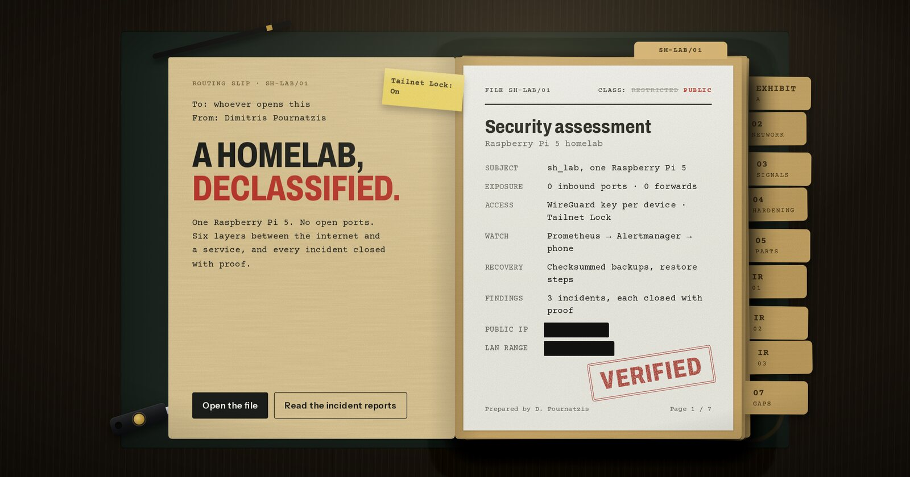
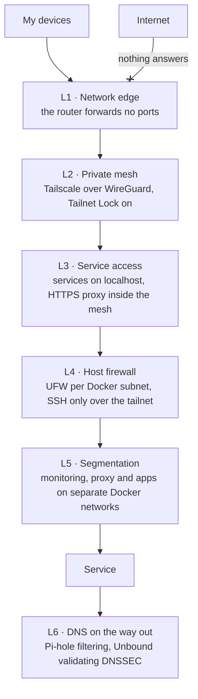

# sh_lab: Raspberry Pi homelab

<p align="center">
  <a href="https://dimpourn.github.io/sh_lab/">
    
  </a>
</p>

<p align="center">
  <a href="https://dimpourn.github.io/sh_lab/"><b>Live site</b></a> ·
  <a href="https://dimpourn.github.io/sh_lab/#incidents"><b>Incident reports</b></a> ·
  <a href="https://dimpourn.github.io/sh_lab/#gaps">Known gaps</a> ·
  <a href="https://dimpourn.github.io/DimPournCV/">CV</a>
</p>

A cybersecurity homelab by Dimitris Pournatzis. I use a Raspberry Pi 5 to practice Linux service
hardening, private networking, monitoring, and recovery. The site presents it as a declassified
case file: each section is a folder on a desk, and every incident report ends with how the fix was
verified.

## Selected work

- **Observability.** Diagnosed a healthy Prometheus scrape that was missing application telemetry, then added and tested a missing-metrics alert.
- **Linux recovery.** Rebuilt a system file ownership baseline from verified packages and local exceptions. Verified the repair across 29,048 paths and confirmed scheduled jobs ran again.
- **Backup automation.** Added retries for delayed backup copies, verified the transferred archives using checksums, and published transfer freshness as a monitoring metric.

## Six layers of defense

Traffic from the internet stops at the first layer. A request from one of my own devices passes
every control on its way to a service, and the last layer filters the lookups that go back out.



The site also lists what this setup does not cover: physical access, dependence on Tailscale's
coordination service, trust in upstream container images, flash storage wear, and a single board
with no failover ([Known gaps](https://dimpourn.github.io/sh_lab/#gaps)).

## The website

GitHub Pages serves the static site from `docs/`: plain HTML, CSS and JavaScript with no build
step. GSAP 3.13.0 and Lenis 1.3.27 are self-hosted in `docs/vendor/`, the fonts in
`docs/assets/fonts/`, and the page makes no third-party requests.

| Control | Implementation | How it is checked |
| --- | --- | --- |
| Content Security Policy | Meta tag: `default-src 'none'`, `script-src 'self'` plus one inline script allowed by its sha256 hash, `style-src 'self'`, `base-uri 'none'`, `form-action 'none'` | No CSP violations in a headless Chromium run at nine screen sizes (2026-11-26) |
| Subresource Integrity | sha384 on all six vendor scripts | Each hash matches `openssl dgst -sha384 -binary <file> \| base64` |
| No third-party requests | Libraries and fonts are self-hosted; no CDNs, trackers or analytics | `default-src 'none'` blocks every other origin |
| Referrer | `no-referrer` | Static review |
| Redactions | The public IP and LAN range on the site are blacked out; the example values behind them are RFC 5737 documentation addresses | A scan of all commits found no real addresses, tailnet names, MAC addresses or keys (2026-11-26) |
| Trusted Types | Not enforced: GSAP's ScrambleText and SplitText plugins write `innerHTML`. The site's own scripts have no HTML sinks | Static review |
| Vulnerability contact | [`security.txt`](https://dimpourn.github.io/.well-known/security.txt) at the domain root, as RFC 9116 requires | n/a |

*(`frame-ancestors` and HSTS need HTTP headers, which GitHub Pages cannot set.)*

**When editing:** if you change the inline script in `docs/index.html`, update its hash in the
policy, or browsers will block it. If you replace a vendor file, update its `integrity` hash.
Bump the `?v=` on `app.js`, `case.js`, `case.css` and `site.css` when you change them, because
GitHub Pages lets browsers cache them for 10 minutes.

## Preview locally

```sh
python3 -m http.server --bind localhost --directory docs 8080
```

Then open <http://localhost:8080/>.

## Tools

The scripts in `tools/` produced generated assets. They are not published.

| Command | What it does | Needs |
| --- | --- | --- |
| `python3 tools/og-desk.py http://127.0.0.1:8080/ docs/assets/img/og-slip.jpg` | Shoots the link-preview card from the desk scene (serve `docs/` first) | Playwright for Python with Chromium |
| `python3 tools/trim-fonts.py <original-fonts-dir> docs/assets/fonts` | Trims the fonts to the characters and weights the CSS uses | `fonttools`, `brotli` |

## Repository layout

| Path | Contents |
| --- | --- |
| `docs/` | The published site; GitHub Pages serves this folder |
| `docs/vendor/` | GSAP and Lenis, with the Lenis licence |
| `docs/assets/` | Fonts with their OFL licences, and the link-preview image |
| `tools/` | Asset scripts |
| `.github/assets/` | The image at the top of this README |

## License

© Dimitris Pournatzis. My content, design and code are licensed under
[CC BY-NC-ND 4.0](LICENSE.md). Third-party files keep their own licences: GSAP (standard
no-charge licence), Lenis (MIT) and the fonts (SIL OFL 1.1). See [CREDITS.md](CREDITS.md).
