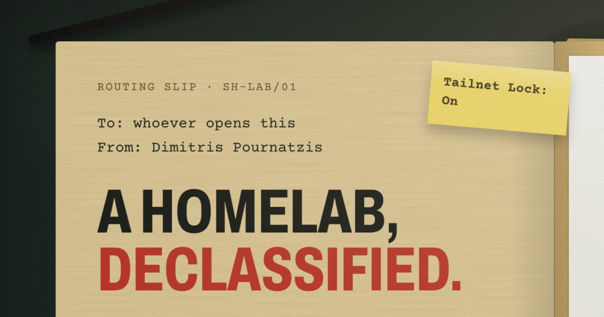

# sh_lab: Raspberry Pi homelab

  

  <a href="https://dimpourn.github.io/sh_lab/"><b>Live site</b></a> ·
  <a href="https://dimpourn.github.io/DimPournCV/">CV</a>

A cybersecurity homelab by Dimitris Pournatzis. I use a Raspberry Pi 5 to practice Linux
hardening, private networking, monitoring, and recovery. The site presents it as a declassified
case file.

## Selected work

- **Monitoring.** Found application metrics missing from a healthy scrape, then added and tested an alert for it.
- **Recovery.** Rebuilt a system file-ownership baseline and verified the repair across 29,048 paths.
- **Backups.** Added retries, checksum verification and freshness monitoring to backup transfers.

## The website

Static HTML, CSS and JavaScript, served by GitHub Pages from `docs/`, with a strict Content
Security Policy, self-hosted libraries and fonts, and no third-party requests. `tools/` holds the
scripts that render the preview image and trim the fonts.

Preview it locally with `python3 -m http.server --bind localhost --directory docs 8080`.

**When editing:** a change to the inline script in `docs/index.html` needs a new hash in the
policy, a replaced file in `docs/vendor/` needs a new `integrity` hash, and edited CSS or JS needs
a new `?v=`.

## License

© Dimitris Pournatzis. Licensed under [CC BY-NC-ND 4.0](LICENSE.md). Third-party files keep their
own licences; see [CREDITS.md](CREDITS.md).
